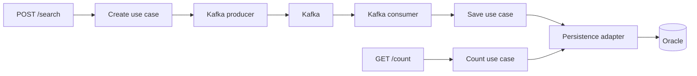

# Technical documentation

[Startup and API examples](../README.md). Run commands from the repository root.

## Architecture

Hexagonal architecture under `com.sling.hotel`:

- `domain`: `HotelSearch` and its invariants. No framework dependencies.
- `application`: create, save, and count use cases; inbound ports and outbound publication/persistence ports. Depends only on the domain.
- `infrastructure`: REST, Kafka, and JPA adapters plus Spring configuration. Adapters connect through ports.

`UseCaseConfig` registers use cases with `@Bean`, keeping Spring out of the application layer. Dependencies use constructor injection. Models and DTOs use records and defensive list copies; no Lombok.



## Validation

REST uses strict JSON deserialization and Bean Validation. The domain checks invariants for both REST requests and Kafka events.

- `hotelId`: required, nonblank, up to 50 UTF-16 code units. Case-sensitive; special characters allowed. No trimming or normalization.
- Dates: required, valid `dd/MM/yyyy` values mapped to `LocalDate`; check-in strictly before check-out. Past dates are allowed. Kafka uses ISO `yyyy-MM-dd`.
- `ages`: 1–50 JSON integers, each 0–100 inclusive. Nulls, strings, decimals, booleans, and invalid structures are rejected. Order and duplicates are preserved.

REST rejects unknown properties. GET requires a nonblank `searchId`. Validation errors return 400 with specific messages, such as `hotelId: hotelId is required` and `checkOut must be after checkIn`.

## Kafka

Topic: `hotel_availability_searches`; key: `searchId`; group: `hotel-search-group`; DLT: `hotel_availability_searches.DLT`. Both topics default to one partition and one replica.

POST waits up to 10 seconds for confirmation (`acks=all`, idempotent producer), not Oracle persistence. A timed-out publication may still reach Kafka. GET reflects only persisted rows.

The consumer acknowledges each record after saving. Transient failures get 60 retries at 5-second intervals, then go to DLT. Invalid messages, idempotency conflicts, and deserialization failures go directly to DLT. DLT publication requires confirmation; there is no automatic replay.

`application.yml` enables virtual threads; `KafkaConfig` configures the listener executor. Consumption and blocking persistence run on the same virtual thread. Defaults are one concurrent listener and 10 Hikari connections. Kafka and Oracle do not share a transaction; Oracle idempotency handles redelivery, without an exactly-once guarantee.

## Oracle

Flyway applies `V1__create_hotel_search_table.sql`; Hibernate validates the schema. All `hotel_search` columns are NOT NULL:

- `search_id VARCHAR2(36 CHAR)`, primary key `pk_hotel_search`.
- `hotel_id VARCHAR2(50 CHAR)`, `check_in`/`check_out DATE`, `ages VARCHAR2(200 CHAR)`.

`idx_hotel_search_identity` indexes hotel, dates, and ages. Date and age rules are enforced in the application. MERGE inserts only when `search_id` is absent; MERGE and count queries use parameters.

- Same ID and payload: ignored as an idempotent duplicate.
- Same ID, different payload: conflict sent to DLT without retries.
- Identical POST requests: separate IDs and rows, each contributing to the count.

Concurrent inserts are handled through Oracle's primary key constraint. Duplicate messages are ignored when the payload matches; conflicting payloads are sent to the DLT.

Ages use CSV to preserve order and duplicates for exact comparison. Fifty ages of 100 occupy 199 characters. Individual-age queries would be better served by native JSON or a child table with positions.

## Logging and traceability

HTTP summaries use INFO; request/response JSON, Kafka metadata, and persistence outcomes use DEBUG. Body logs are limited to 16 KiB and exclude sensitive headers, unknown fields, and unreadable bodies.

`X-Correlation-ID` accepts up to 200 characters matching `[a-zA-Z0-9._:-]+`, otherwise a UUID is generated. It is returned over HTTP and retained in Kafka retries and DLT, independently of `searchId`. The consumer sets MDC on its virtual thread and clears it in `finally`. Errors include context and exceptions.

Enable application DEBUG logging:

```sh
LOG_LEVEL_APP=DEBUG docker compose up -d --build app
```

## Tests and coverage

[Fast tests](../README.md#tests) cover units, MockMvc, immutability, logging, and ArchUnit. The full suite adds embedded Kafka tests for consumption, retries, DLT, and virtual threads, plus Oracle/Testcontainers tests for migrations, MERGE, idempotency, and concurrency, including 100 concurrent POST requests. Testcontainers starts its own Oracle instance.

Full suite with Docker Desktop:

```sh
docker run --rm \
  -v "$PWD:$PWD" -w "$PWD" \
  -v /var/run/docker.sock:/var/run/docker.sock \
  -e DOCKER_HOST=unix:///var/run/docker.sock \
  -e TESTCONTAINERS_HOST_OVERRIDE=host.docker.internal \
  maven:3-eclipse-temurin-25-noble \
  mvn clean verify -Dsurefire.excludedGroups=
```

On local Docker Engine for Linux, omit `TESTCONTAINERS_HOST_OVERRIDE`. The command requires access to the local Docker socket.

JaCoCo 0.8.15 enforces at least 80% BUNDLE coverage for `INSTRUCTION`, `BRANCH`, `LINE`, and `METHOD` during `verify`. `test` generates the report without enforcing thresholds. Reports: `target/site/jacoco/index.html` and `target/surefire-reports/`.

## Benchmark

[`scripts/search-load.js`](../scripts/search-load.js) runs 10,000 shared iterations with 20 virtual users, one POST each, without retries or redirects. Maximum duration: 30 minutes.

With the API running:

```sh
RUN_ID="k6-$(date -u +%Y%m%d%H%M%S)-$$"
printf 'hotelId for this run: %s\n' "$RUN_ID"
docker run --rm -i \
  --network "container:$(docker compose ps -q app)" \
  -e BASE_URL=http://localhost:8080 \
  -e RUN_ID="$RUN_ID" \
  grafana/k6:1.0.0 run - < scripts/search-load.js
```

`RUN_ID` is the shared hotel ID: use a unique value of up to 50 alphanumeric characters, hyphens, or underscores. The payload uses `29/12/2026`, `31/12/2026`, and `[30,29,1,3]`. Adjust `BASE_URL` if `SERVER_PORT` changes.

k6 reports `post_successful` (HTTP 200 with a valid UUID v4), `post_errors`, HTTP/transport failures, throughput (`http_reqs`), and p95/p99 (`http_req_duration`). Thresholds require 10,000 iterations, 10,000 successes, and zero errors; no latency target. The script checks UUID format, not global uniqueness.

### Verify persistence

HTTP success confirms publication. Query Oracle using the same generated `RUN_ID`; repeat while processing is pending:

```sh
docker compose exec -T oracle sh -c \
  'sqlplus -s "$APP_USER/$APP_USER_PASSWORD@//localhost:1521/FREEPDB1"' <<SQL
WHENEVER SQLERROR EXIT SQL.SQLCODE
SET PAGESIZE 100 LINESIZE 200
SELECT COUNT(*) AS persisted_rows,
       COUNT(DISTINCT search_id) AS distinct_ids
FROM hotel_search
WHERE hotel_id = '$RUN_ID'
  AND check_in = DATE '2026-12-29'
  AND check_out = DATE '2026-12-31'
  AND ages = '30,29,1,3';
EXIT;
SQL
```

The command uses container credentials and the default `FREEPDB1` service. Both counts must reach 10,000. A lower count requires checking pending messages, errors, and DLT. These counts do not verify each response ID.

Check consumer lag:

```sh
docker compose exec -T kafka /opt/kafka/bin/kafka-consumer-groups.sh \
  --bootstrap-server kafka:9092 --describe --group hotel-search-group
```

Use the configured group if changed. Zero lag alone does not confirm persistence; messages may be in DLT.

### Results from 11 October 2026

k6 1.0.0 through Docker; `RUN_ID=k6-20261011235145-93632`; 10,000 POST requests with 20 virtual users.

| Metric | Result |
| --- | --- |
| Duration | 11.4 seconds |
| Successful requests | 10,000 (100%) |
| HTTP errors | 0 |
| Throughput | 879.92 requests/second |
| Average HTTP latency | 22.26 ms |
| HTTP latency p95 | 50.87 ms |
| HTTP latency p99 | 103.53 ms |
| Oracle `PERSISTED_ROWS` | 10,000 |
| Oracle `DISTINCT_IDS` | 10,000 |

Persistence was verified in Oracle by `RUN_ID`. Latencies measure HTTP responses, not individual time to Oracle persistence.

## Local environment

Compose uses a single broker without high availability or a persistent Kafka volume. Oracle data survives shutdown; changing credentials does not reinitialize an existing volume.
