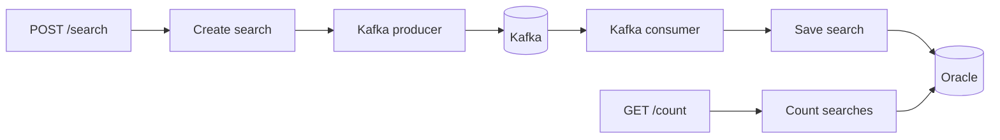

~~# Technical documentation

## Architecture and processing

The project uses hexagonal architecture in a single Maven module. Domain records enforce business invariants without framework dependencies. Application use cases depend on domain types and ports; infrastructure provides REST, Kafka, and Oracle adapters. `UseCaseConfig` registers use cases as Spring beans. Dependencies use constructor injection; records and defensive copies provide immutability without Lombok.



POST creates a UUID for every request and returns **202 Accepted after Kafka confirms publication**. It does not wait for Oracle. A consumer validates the message and persists it before returning. GET uses one combined lookup/count query and returns 404 when the ID is unknown or processing is still pending.

## Validation and error handling

- Check-in and check-out dates use strict `dd/MM/yyyy` parsing with `@FutureOrPresent` validation against an injectable `Clock`. Check-out must be strictly after check-in.
- `hotelId` is required, nonblank, and at most 50 characters. Case-sensitive, not trimmed.
- `ages` contains 1–50 integers between 0 and 100. Null elements, strings, decimals, booleans, and nested structures are rejected. Order and duplicates are preserved.
- Jackson rejects unknown properties, type coercion (numbers/booleans to strings, numbers to dates), and structural mismatches. Bean Validation and domain validation errors return HTTP 400 through `{status, message, errors}`. Missing searches return 404, Kafka failures 503, and unexpected errors 500.
- Kafka deserialization uses the same strict JSON mapper. Null or invalid messages are non-retryable and go directly to DLT. Domain validation also applies during consumption; the consumer does not enforce date-freshness rules, so historical messages remain valid.
- The HTTP logging filter reports unreadable JSON bodies at WARN level and restricts logged fields to the API contract to avoid capturing unexpected input.

## Kafka and traceability

Topic: `hotel_availability_searches`; key: `searchId`; group: `hotel-search-group`; dead-letter topic: `hotel_availability_searches.DLT`.

Producer and consumer are separate adapters. The producer uses `acks=all` and idempotent publication. The listener processes individual records, with synchronous **batch offset commits** after processing the poll. Auto-commit is disabled. Oracle and Kafka do not share a transaction: a crash can cause redelivery, which Oracle idempotency absorbs.

Transient processing errors get 60 retries at five-second intervals before DLT recovery. Invalid messages and deserialization failures go directly to DLT. Recovery preserves original bytes for deserialization failures and requires successful DLT publication. There is no automatic replay.

Spring virtual threads serve HTTP requests; the Kafka listener executor also uses virtual threads. Each consumer performs blocking persistence on its own listener thread. Kafka errors propagate to the error handler.

`X-Correlation-ID` is accepted or generated for HTTP, returned in the response, and propagated through Kafka headers, retries, and DLT. The consumer establishes MDC on its virtual thread and clears it in `finally`. The ID is independent of `searchId`. INFO contains HTTP summaries; DEBUG adds request/response JSON and Kafka/persistence details. Request logging restricts fields to the API contract.

```sh
LOG_LEVEL_APP=DEBUG docker compose up -d --build app
```

## Oracle persistence

Flyway applies `V1__create_hotel_search_table.sql`; Hibernate validates the schema. `hotel_search` has five NOT NULL columns: `search_id VARCHAR2(36 CHAR)`, `hotel_id VARCHAR2(50 CHAR)`, `check_in DATE`, `check_out DATE`, and `ages VARCHAR2(200 CHAR)`.

A parameterized INSERT runs in `REQUIRES_NEW`. The PK `pk_hotel_search` enforces unique IDs. ORA-00001 is ignored only when it identifies this PK, after the failed transaction has ended. No SELECT or payload comparison follows a duplicate: the first committed row remains, including when a redelivery has different content. Other integrity and transient errors propagate. Identical payloads with distinct IDs are separate searches.

GET locates the ID and computes an exact correlated `COUNT(*)` in one statement. `idx_hotel_search_identity (hotel_id, check_in, check_out, ages)` matches the equality predicates and can cover the count; the actual access path depends on Oracle's plan. Bound parameters protect both reads and writes from SQL injection.

Ages use CSV to preserve order and duplicates for exact comparison. Fifty ages of 100 occupy 199 characters. This representation suits identity matching but is inconvenient for querying individual ages; native JSON or a child table would serve different access patterns.

## Performance and database optimizations

POST returns 202 after Kafka `acks=all` confirmation, decoupling HTTP latency from Oracle persistence. GET returns 404 until the consumer processes the message, making the read path eventually consistent.

The adapter uses INSERT rather than MERGE because every `searchId` is a new UUID — the common path is a new row, not an upsert. Redeliveries are absorbed by the PK constraint (`ORA-00001` on `pk_hotel_search`) without a prior SELECT or payload comparison.

`findWithCount` resolves lookup and count in one HQL statement with a correlated subquery, avoiding a second Oracle round trip. `idx_hotel_search_identity (hotel_id, check_in, check_out, ages)` covers the count predicates and can serve as a covering index.

Six Kafka partitions with concurrency=6 allow parallel processing. Reads and writes share a Hikari pool of ten connections (minimum-idle=2), monitored through /actuator/metrics.

k6 end-to-end run (POST + GET polling until visible in Oracle):

| Metric | Result |
| --- | ---: |
| Virtual users | 200 |
| Searches | 10,000 |
| Throughput | 313.23 searches/s |
| Duration | 31.9 s |
| POST p95 | 128.37 ms |
| GET p95 | 225.88 ms |
| Visibility p95 | 1.24 s |
| Errors | 0 |
| Checks passed | 20,000 |

| Environment variable | Default |
| --- | ---: |
| `KAFKA_PARTITIONS` | 6 |
| `KAFKA_LISTENER_CONCURRENCY` | 6 |
| `HIKARI_MAX_POOL_SIZE` | 10 |
| `HIKARI_MIN_IDLE` | 2 |

Spring Boot and Compose use the same defaults; no exports are required. Variables override them.

## Tests and coverage

[README test commands](../README.md#tests) cover fast tests and local Maven execution. Integration tests add embedded Kafka, Oracle/Testcontainers, concurrent INSERTs, redelivery, retries, DLT, virtual threads, and bounded polling for eventual consistency. Testcontainers starts its own Oracle instance.

Full suite with Docker Desktop:

```sh
docker run --rm \
  -v "$PWD:$PWD" -w "$PWD" \
  -v /var/run/docker.sock:/var/run/docker.sock \
  -e DOCKER_HOST=unix:///var/run/docker.sock \
  -e TESTCONTAINERS_HOST_OVERRIDE=host.docker.internal \
  maven:3-eclipse-temurin-25-noble \
  mvn clean verify -Dsurefire.excludedGroups=
```

On local Linux Docker Engine, omit `TESTCONTAINERS_HOST_OVERRIDE`. The Docker socket must be accessible. Without the Maven override, `oracle-integration` is excluded; embedded Kafka still runs.

JaCoCo 0.8.15 enforces at least 80% coverage for instructions, branches, lines, and methods during `verify`, without coverage exclusions. Reports: `target/site/jacoco/index.html` and `target/surefire-reports/`. `mvn test` generates coverage without enforcing the thresholds.

## Benchmark and monitoring

[`scripts/search-load.js`](../scripts/search-load.js) uses shared iterations: one POST per iteration, optionally followed by GET polling until the matching payload is visible. Defaults are 20 VUs and 10,000 iterations; the [README command](../README.md#performance) selects 200 VUs and visibility polling. The first GET is immediate; subsequent 404s wait up to 500 ms, with a 30-second deadline. Use fresh `RUN_ID` values to isolate runs.

k6 reports POST successes/errors, completed-iteration throughput, POST and GET p95/p99, and visibility wait. Visibility includes GET execution and polling delays, not individual Oracle commit latency. Disable visibility polling with `MEASURE_VISIBILITY=false` for a separate POST-only measurement. The payload uses December 2026 dates; update them before they become past dates. See [benchmark results](#performance-and-database-optimizations) for the latest run.

Verify persistence using the same `RUN_ID` from the benchmark terminal. This command uses container credentials and the default `FREEPDB1` service:

```sh
docker compose exec -T oracle sh -c \
  'sqlplus -s "$APP_USER/$APP_USER_PASSWORD@//localhost:1521/FREEPDB1"' <<SQL
WHENEVER SQLERROR EXIT SQL.SQLCODE
SET PAGESIZE 100 LINESIZE 200
SELECT COUNT(*) AS persisted_rows, COUNT(DISTINCT search_id) AS distinct_ids
FROM hotel_search
WHERE hotel_id = '$RUN_ID'
  AND check_in = DATE '2026-12-29'
  AND check_out = DATE '2026-12-31'
  AND ages = '30,29,1,3';
EXIT;
SQL
```

Both counts should reach 10,000. HTTP acceptance confirms Kafka publication; pending processing or DLT can account for missing rows. The script checks UUID format; SQL checks stored uniqueness.

Actuator exposes health and metrics at `/actuator/health` and `/actuator/metrics`, including Hikari pool, Kafka consumer, and JVM statistics.

Check committed group lag:

```sh
docker compose exec -T kafka /opt/kafka/bin/kafka-consumer-groups.sh \
  --bootstrap-server kafka:9092 --describe --group hotel-search-group
```

Compose is a local environment: a single broker without a persistent Kafka volume or high availability. Oracle data survives shutdown. Management endpoints have no access control.~~
